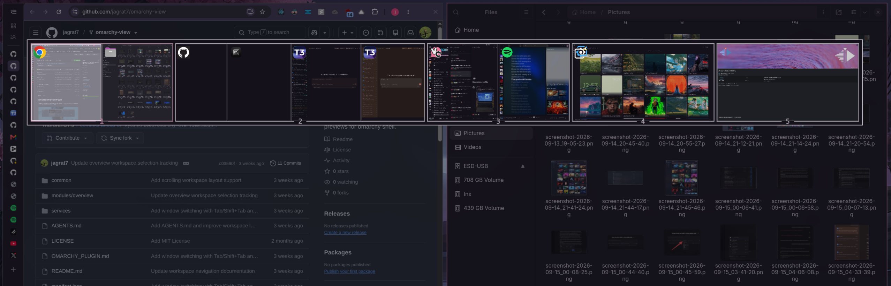

# Omarchy View

A workspace overview and Alt+Tab window switcher for [Omarchy](https://github.com/basecamp/omarchy).



---

## Features

- **Alt+Tab window switching** — hold the modifier and tap `Tab` to cycle windows in most-recently-used order, `Shift+Tab` to go back, and release to focus.
- **Live workspace grid** — see every workspace at once with real-time window previews.
- **Scrolling layout support** — workspaces using Hyprland's scrolling (infinite) layout expand to show windows that are off-screen.
- **Drag and drop** — drag a window onto another workspace to move it there without leaving where you are.
- **Keyboard navigation** — move around the grid with the arrow keys or `H` `J` `K` `L`, and jump to a workspace with the number keys.
- **Mouse actions** — click a window to focus it, click a workspace to switch to it, and middle-click a window to close it.
- **Special workspaces** — optionally show your scratchpads, toggle them, create new ones, and drag windows into them.
- **App icons** — icons for regular apps, web apps, and terminal apps such as Neovim, Yazi and btop.
- **Theme aware** — uses your active Omarchy theme colors and style.
- **Scriptable** — open, close and drive it with `omarchy-shell overview` commands.

---

## Requirements

- Omarchy with shell plugin support (`omarchy plugin` commands). Tested on Omarchy 4.0.6.
- Hyprland with the Lua config (`~/.config/hypr/bindings.lua`). Tested on Hyprland 0.56.2.

---

## Install

```bash
omarchy plugin add https://github.com/jagrat7/omarchy-view.git --enable
```

<details>
<summary>Manual install</summary>

```bash
git clone https://github.com/jagrat7/omarchy-view.git \
  ~/.config/omarchy/plugins/omarchy-view
omarchy-shell shell rescanPlugins
omarchy plugin enable omarchy-view
```

</details>

---

## Set up keybindings

The plugin doesn't change your Hyprland config. Add these lines to
`~/.config/hypr/bindings.lua`, then run `hyprctl reload`:

```lua
hl.unbind("ALT + TAB")
o.bind("ALT + TAB", "Overview", hl.dsp.global("omarchy-view:next"), { repeating = true })
hl.unbind("ALT + SHIFT + TAB")
o.bind("ALT + SHIFT + TAB", "Overview (reverse)", hl.dsp.global("omarchy-view:previous"), { repeating = true })
```

To use `SUPER` or `CTRL` as well (or instead), repeat the lines with that
modifier in place of `ALT`. The `hl.unbind` lines free the key from any
existing binding.

---

## Usage

### Keys

Hold the modifier and press `Tab` to open the overview. Release the modifier to
focus the highlighted window, or switch to the selected workspace if it's empty.

| Key | Action |
| :--- | :--- |
| `Tab` / `Shift+Tab` | Highlight the next / previous window |
| `←` `→` `↑` `↓` or `H` `J` `K` `L` | Move between workspaces in the grid (wraps at the edges) |
| `1`–`9`, `0` | Jump to workspace 1–9 of the current group (`0` is the tenth) |
| `Enter` | Focus the highlighted window now |
| `Escape` | Close without changing anything |

### Mouse

| Action | Result |
| :--- | :--- |
| Left-click a window | Focus it |
| Middle-click a window | Close it |
| Drag a window onto a workspace | Move it there (you stay where you are) |
| Click a workspace | Switch to it |
| Click outside the overview | Close the overview |

When special workspaces are shown, clicking one toggles it, and the
**New special** tile creates a new one.

### Workspace groups

The grid shows `rows × columns` workspaces at a time (10 by default) and shows
the group that contains your current workspace. With the defaults, workspaces
1–10 are one group and 11–20 the next. Tab cycling stays within the current
group, plus special workspaces if they're shown.

### Shell commands

```bash
omarchy-shell overview open      # open without starting a window switch
omarchy-shell overview close     # close without changing focus
omarchy-shell overview next      # open, or highlight the next window
omarchy-shell overview previous  # open, or highlight the previous window
omarchy-shell overview commit    # focus the highlighted window and close
omarchy-shell overview state     # prints "open" or "closed"
```

When opened with `open`, the overview stays open until you click, press
`Enter`, or press `Escape`.

---

## Configuration

Add settings to the plugin's entry in the `plugins` array of
`~/.config/omarchy/shell.json`, for example:

```json
{ "id": "omarchy-view", "rows": 2, "columns": 5 }
```

| Setting | Type | Default | Description |
| :--- | :--- | :--- | :--- |
| `rows` | integer | `2` | Rows in the workspace grid (1–10). |
| `columns` | integer | `5` | Columns in the workspace grid (1–20). |
| `hideEmptyRows` | boolean | `true` | Hide grid rows whose workspaces have no windows. The row with your current workspace is always shown. |
| `showSpecialWorkspaces` | boolean | `false` | Show special (scratchpad) workspaces below the grid. |
| `specialWorkspaceColumns` | integer | `5` | Columns used for the special workspace row. |
| `showIcons` | boolean | `true` | Show app icons on window previews. |

If a change doesn't show up, run `omarchy restart shell`.

---

## Update

```bash
omarchy plugin update omarchy-view
omarchy restart shell
```

---

## Uninstall

```bash
omarchy plugin remove omarchy-view
```

Then remove the `omarchy-view` keybindings from `~/.config/hypr/bindings.lua`
and run `hyprctl reload`.

---

## Troubleshooting

**Alt+Tab does nothing, or opens something else.**
- Check that the plugin is enabled: `omarchy plugin list | grep omarchy-view`.
- Check that the shortcuts exist: `hyprctl globalshortcuts | grep omarchy-view`.
  If they're missing, run `omarchy restart shell`.
- Check what the key is bound to: `hyprctl binds | grep -B2 -A6 "key: TAB"`.
  Another plugin, or a later line in your config, may be overriding it.

**The overview stays open after I release the modifier.** Only `Alt`, `Super`
and `Ctrl` count as hold modifiers. Press `Enter` to focus the highlighted
window or `Escape` to close.

**Upgrading from an older version of this fork.** Versions before 2.0.0 used the
id `omarchy-overview`. Run `omarchy plugin remove omarchy-overview`, install
this one, and change your binds to `omarchy-view:next` / `omarchy-view:previous`.

---

## Credits

- Maintained by [jagrat7](https://github.com/jagrat7).
- Based on [AyushKr2003/omarchy-overview](https://github.com/AyushKr2003/omarchy-overview), which adapted the overview for Omarchy's plugin system, IPC and icon library.
- Originally [Shanu-Kumawat/quickshell-overview](https://github.com/Shanu-Kumawat/quickshell-overview).
